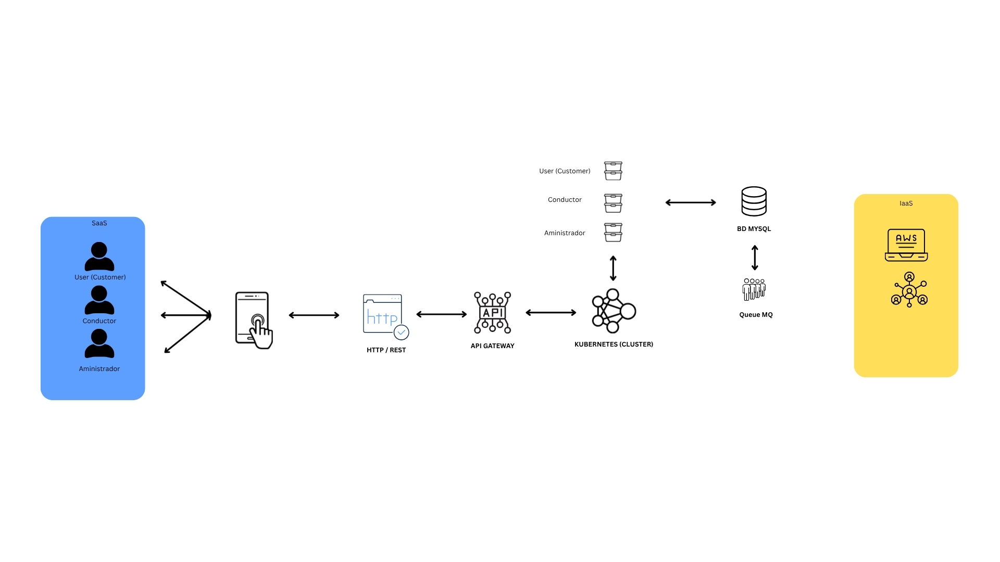

# Documentación Hito 1

## Desripción del problema:

### Problema

Las rutas de los servicios de transporte intermunicipales tienen un horario establecido que se publica en una tabla impresa en cada bus o parada. Estos servicios tienen un horario establecido por cada parada.

Actualmente el servicio no es estable, los tiempos en google maps no son correctos y las paradas tampoco. Tiene demoras, no hay actualización en tiempo de real del estado del transporte o una posible llegada en cada parada. Estableciendo un ejemplo, para el destino de Durcal en su primera parada uno de los servicios tiene como horario de llegada 11:06 AM. De los cuales pueden pasar entre 10/15 minutos de espera sin saber una actualización de este. 

## bjetivo

Generar una aplicación distribuida con sistemas en la nube, que permita gestionar más que la geoposición, un tiempo/horario exacto y estado del bus para cada parada. Con el fin de obtener un tiempo más exacto sin perder el servicio o esperar de más. 

- Control de horarios más precisos. 
- Estado de del servicio. 
- Información del servicio si es apto para personas con discapacidad movil y se disponga de una rampa. 
- Registro de servicios.
- Busqueda por servicios.
- Información sobre estado de la ruta (Cierres o posibles desvios.)

# Justificación NIST SP 800-145

- Kubernetes para la orquestación de microservicios. 
- Docker para contener la imagenes. 
- MySql para la persistencia. 
- Api Gateway para la gestión de solicitudes. 

| Caracteristicas | Justificación |
|--|--|
|Acceso por red| Comunicación mediante API GATEWAY y protocolos de red.|
|Recursos agrupados| Recursos compartidos entre los microservicios del cluster.|
|Elasticidad| Posibilidad de escalar réplicas de los microservicios.|
|Servicio Medido | Monitorización de la CPU, memoria y red.| 

# Mapeo de actores NIST SP 500-292

|Actor| Impactos economicos | Aplicación en MiBus|
|--|--|
|Usuarios que disponen de transporte intermunicipal|Asume el costo de la descarga para utilizar la Aplicación| Buses intermunicipales |
|Proovedor| Monetización por servicios prestados | Empresa que proporciona el servicio de cloud donde la aplicación se ejecutará.|
|Intermediario| Podría añadir costes de gestión para simplicar la operatvida
|Auditor| Generación por costes de auditoria para evaluar y mediar que la aplicación cumpla los requsitos minimos de seguridad, operación e integración | Entidad tercera que preste el servicio de auditoria.|

# Especificación API REST

|Metodo HTTP| Endpoint| Descripcioón|
|--|--|--|
|POST|/auth/createVehicule| Crea un bus intermunicipal.|
|POST|/auth/loginRoutes| Login del conductor.|
|POST|/numberRoute| Crea las rutas disponibles a nivel intermunicipal.|
|GET|/numberRoute| Obtiene las rutas disponibles|
|POST|/schedule| Obtiene los horarios de llegada por parada.|
|POST|/numberRoute/{id}/driver| Crear un conductor.|
|GET|/updates| Obtiene actualizaciones de las vías y/o posibles desvios.|
|POST|/updates| Crea una alerta de modo informativa.|

# Diagrama de arquitectura. 

